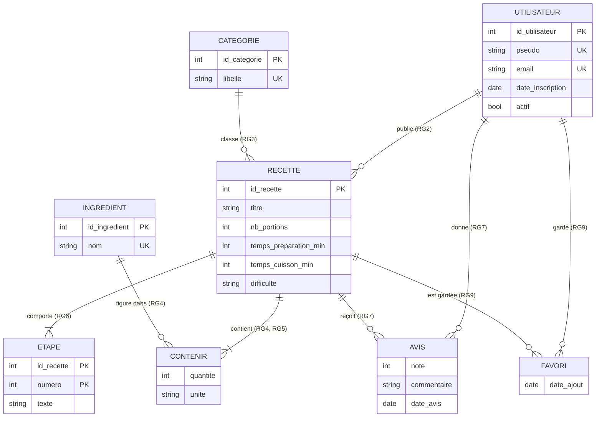

# Conception : site de recettes de cuisine

Sujet : un site où des utilisateurs publient des recettes, les classent par catégorie, les notent et les mettent en favori.

## 1. Cahier des charges

### 1.1 Règles de gestion

| N° | Règle | Ce qu'on en déduit |
|---|---|---|
| RG1 | Un utilisateur s'inscrit avec un pseudo et une adresse e-mail. Le pseudo est unique sur le site, l'e-mail aussi. | Pseudo et e-mail : contraintes d'unicité ; ce sont des identifiants métier possibles. |
| RG2 | Un utilisateur peut publier zéro, une ou plusieurs recettes. Une recette a toujours un seul auteur. | Utilisateur (0,N) – Recette (1,1). |
| RG3 | Une recette appartient à exactement une catégorie (entrée, plat, dessert, boisson, etc.). Une catégorie peut ne contenir aucune recette. | Recette (1,1) – Catégorie (0,N). |
| RG4 | Une recette contient au moins un ingrédient. Les ingrédients forment un catalogue partagé : un ingrédient est identifié par son nom, unique, et peut figurer dans plusieurs recettes ou dans aucune. | Recette (1,N) – Ingrédient (0,N) ; nom d'ingrédient unique. |
| RG5 | Pour chaque ingrédient d'une recette, on indique toujours une quantité (strictement positive) et une unité choisie dans une liste fermée (g, kg, ml, cl, l, c. à café, c. à soupe, pièce, pincée). Un même ingrédient ne figure qu'une fois dans une recette. | L'association Recette–Ingrédient porte quantité et unité, toutes deux obligatoires ; une seule ligne par couple (recette, ingrédient). |
| RG6 | Une recette comporte au moins une étape. Les étapes sont numérotées à partir de 1, sans trou, et le texte de l'étape est obligatoire. Une étape appartient à une seule recette. | Étape (1,1) – Recette (1,N) ; l'étape est identifiée par la recette et son numéro. |
| RG7 | Un utilisateur peut donner un avis sur une recette : une note de 1 à 5 et un commentaire facultatif. Il donne au plus un avis par recette. | Utilisateur (0,N) – Recette (0,N) ; l'association porte la note, le commentaire et la date ; une seule ligne par couple. |
| RG8 | Un utilisateur ne peut pas noter sa propre recette. | Contrainte entre associations : non exprimable par le schéma seul (voir section « Ce que le schéma ne garantit pas »). |
| RG9 | Un utilisateur peut mettre en favori zéro, une ou plusieurs recettes. Une recette peut être mise en favori par plusieurs utilisateurs. Un même couple (utilisateur, recette) n'existe qu'une fois. | Utilisateur (0,N) – Recette (0,N) ; l'association porte la date d'ajout. |
| RG10 | Une recette a un titre obligatoire, un nombre de portions supérieur ou égal à 1, et un temps de préparation et de cuisson en minutes (supérieurs ou égaux à 0). Un auteur ne peut pas publier deux recettes de même titre. | Contraintes de domaine ; unicité du couple (auteur, titre). |
| RG11 | Supprimer une recette supprime ses étapes, ses lignes d'ingrédients, ses avis et ses favoris, mais jamais les ingrédients du catalogue, les catégories ni les utilisateurs. Un compte utilisateur n'est pas supprimé mais désactivé : ses recettes et avis restent. | Suppression en cascade depuis Recette ; l'utilisateur porte un indicateur « actif ». |

### 1.2 Les questions qu'on s'est posées et la réponse retenue

| Question | Réponse retenue | Règle |
|---|---|---|
| Une catégorie peut-elle être vide ? | Oui : on peut créer « Boissons » avant la première recette. | RG3 |
| Une recette peut-elle avoir plusieurs catégories ? | Non, une seule, pour que le classement reste simple. Les régimes (végétarien, sans gluten) et les étiquettes libres sont hors périmètre. | RG3 |
| Une recette peut-elle exister sans ingrédient, ou sans étape ? | Non : au moins un ingrédient et au moins une étape. | RG4, RG6 |
| Un ingrédient du catalogue peut-il n'être dans aucune recette ? | Oui, le catalogue existe indépendamment des recettes. | RG4 |
| L'unité d'une quantité est-elle libre ? | Non, liste fermée, sinon « 2 cuillères », « 2 c.s. » et « 2 cuil. à soupe » ne se comparent pas. | RG5 |
| Les étapes sont-elles réordonnables ? | Oui, par renumérotation ; le numéro d'ordre fait partie de l'identité de l'étape. | RG6 |
| Peut-on modifier ou retirer son avis ? | Le modifier, oui (il remplace le précédent, car un seul avis par recette). Le retirer, oui. | RG7 |
| L'auteur peut-il noter sa propre recette ? | Non, sinon la note moyenne est faussée. | RG8 |
| Que devient une recette si son auteur quitte le site ? | Elle reste : le compte est désactivé et non supprimé. | RG11 |
| Une recette peut-elle être une variante d'une autre ? | Hors périmètre : on ne modélise pas les liens entre recettes. | (aucune) |
| La note moyenne est-elle stockée ? | Non, elle se calcule à partir des avis (le choix dénormaliser ou non est tranché dans l'ADR). | RG7 |

## 2. MCD

### 2.1 Entités et identifiants

| Entité | Attributs | Identifiant | Identifiant métier |
|---|---|---|---|
| UTILISATEUR | pseudo, email, date d'inscription, actif | id_utilisateur | pseudo (unique), e-mail (unique) |
| RECETTE | titre, description, nb de portions, temps de préparation (min), temps de cuisson (min), difficulté, date de publication | id_recette | (id_auteur, titre) unique ; un slug d'URL unique serait possible |
| CATEGORIE | libellé | id_categorie | libellé (unique) |
| INGREDIENT | nom, unité usuelle | id_ingredient | nom (unique) |
| ETAPE | numéro, texte, durée (facultative, en min) | identifiant relatif : id_recette + numéro | (id_recette, numéro) |

Notes :
- ETAPE est une entité faible : elle n'existe que dans une recette (RG6, RG11), d'où son identifiant relatif.
- L'identifiant technique (`id_...`) sert aux liens ; l'identifiant métier garantit qu'on ne crée pas deux fois le même objet réel (deux « tomate », deux pseudos identiques).

### 2.2 Associations qui portent des données

| Association | Entités reliées | Données portées | Pourquoi ici et pas sur une entité |
|---|---|---|---|
| CONTENIR | RECETTE (1,N) – INGREDIENT (0,N) | quantité, unité | La quantité de tomate n'est ni celle de la tomate en général, ni celle de la recette en général : elle dépend du couple (RG5). |
| NOTER (avis) | UTILISATEUR (0,N) – RECETTE (0,N) | note, commentaire, date | Une note n'appartient ni à l'utilisateur ni à la recette seuls : c'est l'avis d'un utilisateur sur une recette (RG7). |
| METTRE EN FAVORI | UTILISATEUR (0,N) – RECETTE (0,N) | date d'ajout | Même raisonnement (RG9). |

### 2.3 Proposition de schéma (à valider par la personne qui rédige les associations)



### 2.4 Associations et cardinalités (chacune appuyée sur une règle)

Lecture : « (min,max) » écrit à côté d'une entité dit combien de fois **cette entité** participe à l'association. Dans le schéma Mermaid ci-dessus, le symbole est lu de l'autre côté : `UTILISATEUR ||--o{ RECETTE` signifie qu'un utilisateur a 0 à n recettes et qu'une recette a exactement un utilisateur. Le schéma 2.3 est cohérent avec ce tableau.

| Association | Entité 1 | Entité 2 | Règle | Pourquoi ces bornes |
|---|---|---|---|---|
| PUBLIER | UTILISATEUR (0,N) | RECETTE (1,1) | RG2 | Un compte peut n'avoir rien publié ; une recette a toujours un seul auteur. |
| CLASSER | CATEGORIE (0,N) | RECETTE (1,1) | RG3 | Une catégorie peut être vide ; une recette a exactement une catégorie. |
| COMPORTER | RECETTE (1,N) | ETAPE (1,1) | RG6 | Au moins une étape par recette ; une étape appartient à une seule recette (entité faible). |
| CONTENIR *(quantité, unité)* | RECETTE (1,N) | INGREDIENT (0,N) | RG4, RG5 | Au moins un ingrédient par recette ; un ingrédient du catalogue peut ne servir à rien. Un seul couple (recette, ingrédient). |
| NOTER *(note, commentaire, date)* | UTILISATEUR (0,N) | RECETTE (0,N) | RG7, RG8 | Un avis par couple au plus ; l'auteur ne peut pas noter sa recette (RG8, contrainte entre associations). |
| METTRE EN FAVORI *(date d'ajout)* | UTILISATEUR (0,N) | RECETTE (0,N) | RG9 | Un favori par couple au plus. |

Identifiant des trois associations porteuses de données : le couple des deux identifiants (RG5, RG7, RG9).

## 3. MLD dans la base choisie

Base retenue : **MongoDB** (voir l'ADR `docs/adr/0001-….md`). Six collections : `utilisateurs`, `categories`, `ingredients`, `recettes`, `avis`, `favoris`. Les identifiants techniques `id_...` deviennent des `_id` (ObjectId). Les identifiants métier deviennent des **index uniques**.

### 3.1 Où va chaque association, et pourquoi

| Association (règle) | Rangement | Pourquoi |
|---|---|---|
| COMPORTER : Recette–Étape (RG6) | **Imbriquée** : tableau `etapes` dans `recettes` | L'étape est une entité faible : elle n'existe pas sans sa recette et disparaît avec elle (RG11). Elle est peu nombreuse (une dizaine), jamais lue seule, et la recette se lit en un seul accès. Son identifiant relatif (recette + numéro) devient la position et le champ `numero` dans le tableau. |
| CONTENIR : Recette–Ingrédient, avec quantité et unité (RG4, RG5) | **Imbriquée** dans `recettes` (tableau `ingredients`) avec **référence** `ingredient_id` et **copie** du `nom` | La quantité n'a de sens que dans une recette, et la recette se lit toujours avec ses ingrédients. Le catalogue reste une collection à part (RG4 : un ingrédient peut ne servir à aucune recette ; nom unique). L'index sur `ingredients.ingredient_id` répond à « quelles recettes utilisent X ? ». |
| PUBLIER : Utilisateur–Recette (RG2) | **Référencée** : `auteur_id` dans `recettes`, avec **copie** de `auteur_pseudo` | Un utilisateur publie un nombre sans borne de recettes : les imbriquer dans l'utilisateur ferait un document qui grossit. Le pseudo copié évite un second accès pour afficher « par Léa ». |
| CLASSER : Catégorie–Recette (RG3) | **Référencée** : `categorie_id` dans `recettes` | Une catégorie peut être vide (RG3) : elle doit exister seule. Une seule catégorie par recette, donc un champ simple, pas un tableau. La liste des catégories est courte : on affiche le libellé en la lisant à part. |
| NOTER : Utilisateur–Recette, avec note, commentaire, date (RG7) | **Collection `avis` séparée**, référencée (`recette_id`, `utilisateur_id`) | Nombre sans borne par recette, écrit souvent, lu par page. Un **index unique** `(recette_id, utilisateur_id)` garantit un seul avis par couple ; modifier son avis le remplace (`replaceOne` avec `upsert`). |
| METTRE EN FAVORI : Utilisateur–Recette, avec date d'ajout (RG9) | **Collection `favoris` séparée**, référencée (`utilisateur_id`, `recette_id`, `date_ajout`) | L'association porte une donnée (la date). Une recette populaire peut avoir des milliers de favoris, donc on ne les imbrique ni dans la recette ni dans l'utilisateur. L'index unique `(utilisateur_id, recette_id)` garantit RG9, et RG11 se fait par un seul `deleteMany({recette_id})`. |

### 3.2 Les entités et leurs identifiants dans la base

| Collection | Identifiant technique | Identifiants métier (index uniques) |
|---|---|---|
| `utilisateurs` | `_id` | `pseudo`, `email` (RG1) |
| `recettes` | `_id` | `(auteur_id, titre)` (RG10) |
| `categories` | `_id` | `libelle` |
| `ingredients` | `_id` | `nom` (RG4) |
| `avis` | `_id` | `(recette_id, utilisateur_id)` (RG7) |
| `favoris` | `_id` | `(utilisateur_id, recette_id)` (RG9) |

### 3.3 Copies faites exprès (dénormalisation)

| Copie | Où | Pourquoi | Qui la tient à jour |
|---|---|---|---|
| `ingredients[].nom` | `recettes` | Afficher la recette sans jointure | Renommer un ingrédient est rare : `updateMany` dans le code d'administration |
| `auteur_pseudo` | `recettes` | Idem | Un compte est désactivé, pas supprimé (RG11) ; si le pseudo change, `updateMany` |
| Note moyenne | **non stockée** | Conforme à la section 1.2 : elle se calcule avec une agrégation `$avg` sur `avis` (index sur `recette_id`) | Rien à maintenir. Le coût est dit dans l'ADR (calcul à chaque affichage de liste). |

### 3.4 Exemples de documents

```json
// recettes
{
  "_id": "ObjectId(...)",
  "titre": "Tarte aux pommes", "description": "…",
  "auteur_id": "ObjectId(...)", "auteur_pseudo": "lea",
  "categorie_id": "ObjectId(...)",
  "nb_portions": 6, "temps_preparation_min": 30, "temps_cuisson_min": 40,
  "difficulte": "facile", "date_publication": "2026-11-13",
  "ingredients": [
    { "ingredient_id": "ObjectId(...)", "nom": "pomme",  "quantite": 5,   "unite": "pièce" },
    { "ingredient_id": "ObjectId(...)", "nom": "farine", "quantite": 250, "unite": "g" }
  ],
  "etapes": [
    { "numero": 1, "texte": "Étaler la pâte." },
    { "numero": 2, "texte": "Disposer les pommes.", "duree_min": 40 }
  ]
}
// avis
{ "recette_id": "ObjectId(...)", "utilisateur_id": "ObjectId(...)", "note": 5, "commentaire": "Délicieuse", "date_avis": "2026-11-13" }
// favoris
{ "utilisateur_id": "ObjectId(...)", "recette_id": "ObjectId(...)", "date_ajout": "2026-11-13" }
```

## 4. Ce que le schéma ne garantit pas

### 4.1 Ce que le schéma garantit (validateur JSON Schema et index uniques, `modele/creer_base.js`)

- Pseudo, e-mail uniques (RG1) ; nom d'ingrédient unique (RG4) ; libellé de catégorie unique.
- Au moins un ingrédient et au moins une étape (RG4, RG6) ; texte d'étape obligatoire ; numéro ≥ 1.
- Quantité obligatoire et strictement positive, unité dans la liste fermée (RG5).
- Note de 1 à 5 (RG7) ; un seul avis par couple (RG7) ; un seul favori par couple (RG9).
- Portions ≥ 1, temps ≥ 0, titre obligatoire (RG10) ; un auteur ne peut pas avoir deux recettes de même titre (RG10).

### 4.2 Ce que le schéma ne garantit pas, et où on le garantit

| Ce qui n'est pas garanti | Règle | Pourquoi MongoDB ne le garantit pas | Où on le garantit |
|---|---|---|---|
| Un utilisateur ne note pas sa propre recette | RG8 | Une contrainte entre deux collections ne s'exprime pas dans un validateur | **Code** : refuser si `auteur_id == utilisateur_id` (`modele/ajouter_avis.js`) |
| `auteur_id`, `categorie_id`, `ingredient_id`, `recette_id`, `utilisateur_id` pointent vers un document existant | RG2, RG3, RG4, RG7, RG9 | Pas de clé étrangère | **Code** : vérifier l'existence avant d'écrire |
| Un même ingrédient n'apparaît qu'une fois dans une recette | RG5 | `uniqueItems` compare des objets entiers, pas le seul `ingredient_id` ; un index unique ne s'applique pas à l'intérieur d'un tableau | **Code** : dédoublonner avant d'écrire la recette |
| Numéros d'étapes à partir de 1, **sans trou** | RG6 | Un validateur ne compare pas les éléments d'un tableau entre eux | **Code** : renuméroter à chaque écriture ou réordonnancement |
| Suppression en cascade : avis et favoris d'une recette supprimée ; ni ingrédients, ni catégories, ni utilisateurs touchés | RG11 | Pas de `ON DELETE CASCADE` (les étapes et lignes d'ingrédients, imbriquées, partent seules avec la recette) | **Transaction** : supprimer la recette, ses `avis` et ses `favoris` (`modele/supprimer_recette.js`) |
| Désactiver un compte plutôt que le supprimer | RG11 | Rien n'empêche un `deleteOne` sur un utilisateur | **Code** : pas de route de suppression d'utilisateur ; droits de la base (rôle sans `remove` sur `utilisateurs`) |
| Cohérence des copies (`ingredients[].nom`, `auteur_pseudo`) | (dénormalisation) | Une copie n'est pas surveillée par la base | **Code** : `updateMany` à chaque renommage ; un script de contrôle compare copies et sources |
| Impossible de supprimer une catégorie utilisée | RG3 | Pas de clé étrangère | **Code** : refuser tant qu'une recette la référence |

**Limite** : les transactions multi-documents (cascade RG11) exigent un *replica set*, même à un seul nœud. Un `mongod` seul les refuse.
